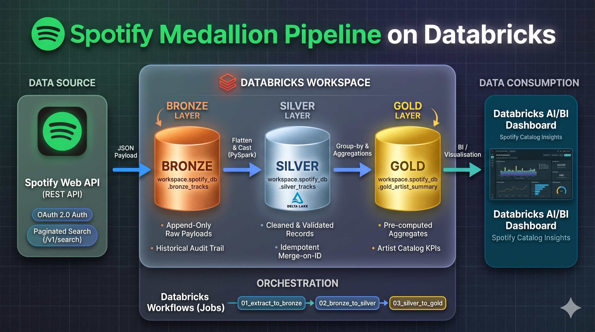
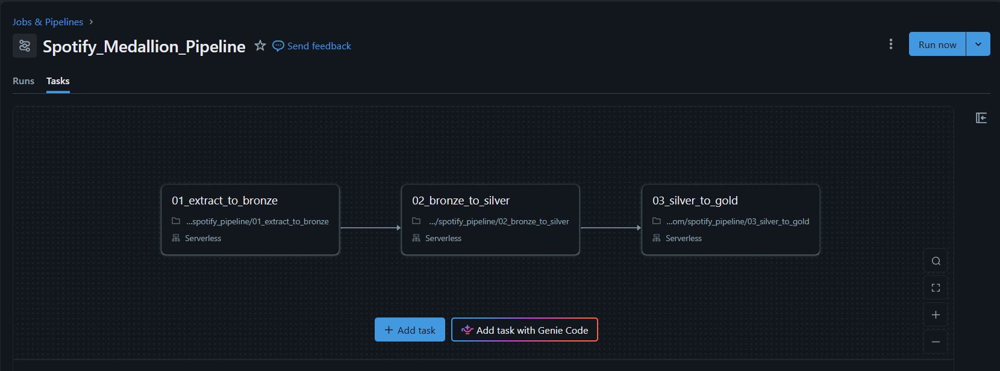

# End-to-End Spotify Data Pipeline (Medallion Architecture on Databricks)

An automated, production-style data engineering pipeline ingesting catalog data from the **Spotify Web API**, transforming it across a **Medallion Architecture (Bronze $\rightarrow$ Silver $\rightarrow$ Gold)** using **PySpark** and **Delta Lake**, scheduled via a multi-task **Databricks Workflow Job**, and surfaced through an interactive **Databricks AI/BI Dashboard**.

---

## Architecture Overview

```
[Spotify Web API (REST)]
           │
           │  (Client Credentials Flow / Paginated Ingestion)
           ▼
┌─────────────────────────┐
│      BRONZE LAYER       │  workspace.spotify_db.bronze_tracks
│  (Append-Only Raw JSON) │  Raw payload audit trail with ingestion metadata
└───────────┬─────────────┘
            │
            │  (PySpark Schema Parsing, Dedup, Type Casting)
            ▼
┌─────────────────────────┐
│      SILVER LAYER       │  workspace.spotify_db.silver_tracks
│   (Cleansed / Conformed)│  Idempotent Delta MERGE INTO (upsert by track_id)
└───────────┬─────────────┘
            │
            │  (Aggregations & Analytics)
            ▼
┌─────────────────────────┐
│       GOLD LAYER        │  workspace.spotify_db.gold_artist_summary
│  (Aggregated Analytics) │  Artist catalog KPIs & release windows
└───────────┬─────────────┘
            │
            ▼
┌─────────────────────────┐
│     BI CONSUMPTION      │  Databricks AI/BI Dashboard
│   (Metrics & Visuals)   │  Live reporting on track volume & duration trends
└─────────────────────────┘
```

---

## Architecture Diagram



---

## Key Pipeline Features

1. **Authentication & Rate Handling:**
   - Authenticates using OAuth 2.0 Client Credentials flow (`/api/token`).
   - Implements offset-based pagination and rate-limit backoffs against Spotify's catalog search endpoints.
2. **ACID Transactions & Schema Enforcement:**
   - Raw JSON landed in **Bronze** as an immutable, append-only historical record.
   - Cleansed data flattened and merged into **Silver** using `DeltaTable.merge()` to ensure idempotent runs without duplicate primary keys.
3. **Analytical Gold Aggregations:**
   - Pre-computes artist-level metrics (total track counts, average duration, historical release windows) for immediate downstream BI consumption.
4. **Automated Orchestration:**
   - Managed via a visual, multi-task **Databricks Job DAG** with upstream dependency tracking and parameter injection.
5. **Consumption Layer:**
   - Native **Databricks AI/BI Dashboard** displaying artist chart dominance and song length distributions.

---

## Pipeline Execution & DAG



---

## Repository Structure

```text
├── notebooks/
│   ├── 01_extract_to_bronze.py    # Spotify API extraction to raw Bronze Delta table
│   ├── 02_bronze_to_silver.py     # Schema parsing, dedup, and idempotent MERGE INTO
│   └── 03_silver_to_gold.py       # Artist summary aggregations for reporting
│   ├── 04_master_orchestrator.py  # Alternative notebook runner via dbutils.notebook.run
├── docs/assets/                   # Architecture screenshots
├── .gitignore
└── README.md
```

---

## Setup & Execution Guide

### Prerequisites
- Databricks Workspace (Community Edition or Cloud).
- Spotify Developer Account with a registered application (`Client ID` and `Client Secret`).

### Deployment Steps
1. Import the notebooks in the `/notebooks` folder into your Databricks workspace.
2. Create the target catalog and database:
   ```sql
   CREATE DATABASE IF NOT EXISTS workspace.spotify_db;
   ```
3. Set up a multi-task job under **Jobs & Pipelines**:
   - **Task 1 (`01_extract_to_bronze`):** Add parameters `spotify_client_id` and `spotify_client_secret`.
   - **Task 2 (`02_bronze_to_silver`):** Set dependency on Task 1.
   - **Task 3 (`03_silver_to_gold`):** Set dependency on Task 2.
4. Click **Run now** to trigger the pipeline end-to-end.